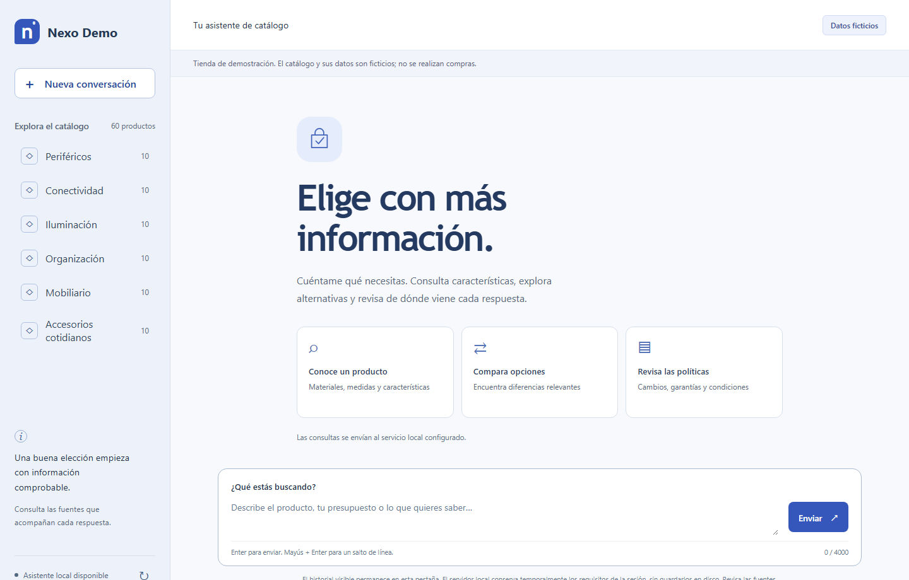
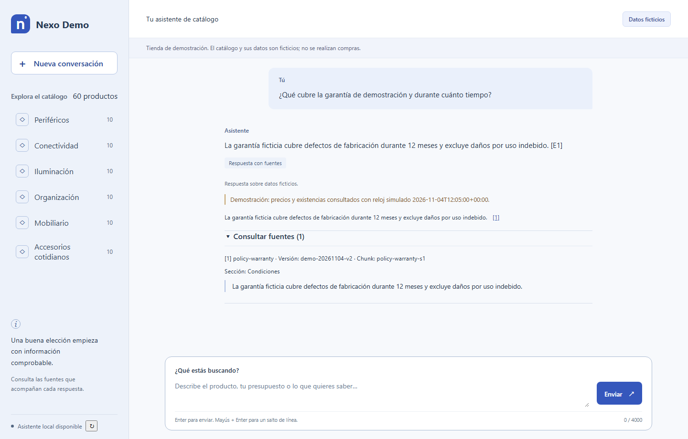
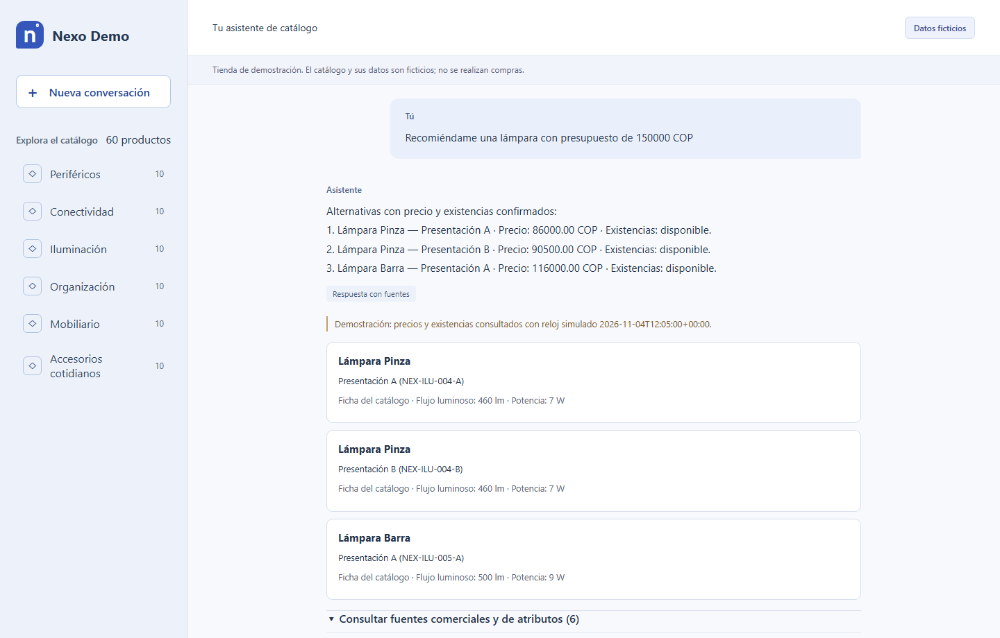

# INFORME DE AVANCE — UNIVERSIDAD DE SANTANDER (UDES)


| Campo | Información del proyecto |
| --- | --- |
| **Título del proyecto** | Desarrollo de un asistente conversacional basado en RAG para la consulta y asesoría sobre productos de una tienda (Prototipo Nexo Demo) |
| **Estudiante(s) / Autor(es)** | `[Completar nombre(s) completo(s) y código(s) estudiantil(es)]` |
| **Docente / Director** | `[Completar nombre del docente o director del proyecto]` |
| **Asignatura / Programa** | `[Completar asignatura y programa académico — Universidad de Santander (UDES)]` |
| **Fecha de presentación** | 4 de noviembre de 2026 |
| **Estado general** | Fases 1 a 6 implementadas y operativas en entorno local; Fases 7 y 8 en preparación |

---

## 1. OBJETIVO DEL INFORME

Presentar de manera estructurada y verificable los avances alcanzados durante el desarrollo del proyecto **«Desarrollo de un asistente conversacional basado en RAG para la consulta y asesoría sobre productos de una tienda»**, describiendo las actividades ejecutadas desde la definición de requisitos y arquitectura hasta la puesta en marcha del prototipo web integrado en español sobre la tienda de demostración **Nexo Demo**. Asimismo, documentar los resultados obtenidos con sus respectivas evidencias técnicas (métricas de ingesta y recuperación, pruebas automatizadas, fragmentos de código, salidas de servicio y capturas de ejecución real), las dificultades presentadas junto con su solución y las actividades pendientes para culminar la evaluación final y el estudio de utilidad con participantes.

---

## 2. AVANCES DEL PROYECTO

El proyecto se estructuró en ocho fases secuenciales y trazables a los seis objetivos específicos formulados en el documento de fundamentos. A la fecha de corte (4 de noviembre de 2026), se han completado e integrado operativamente los componentes técnicos correspondientes a las **Fases 1 a 6**, y se ha preparado la infraestructura de medición y entrega de las **Fases 7 y 8**:

| Fase del proyecto | Objetivo específico asociado | Actividades y procedimientos realizados | Herramientas utilizadas |
| --- | --- | --- | --- |
| **Fase 1: Definición de tienda, requisitos y protocolo** | OE1: Caracterizar necesidades, categorías y requisitos; OE5: Diseñar evaluación | Definición de Nexo Demo (6 categorías, 60 productos, 90 variantes). Especificación de 14 requisitos funcionales y 8 de sustitución de tienda. Diseño del protocolo con 60 casos de ajuste, 60 casos finales reservados e instrumentos para 8 participantes. | Especificaciones Markdown, JSON Schema, diseño experimental antes de medir resultados. |
| **Fase 2: Arquitectura y base técnica local** | OE3: Diseñar arquitectura integrada y contexto conversacional | Implementación de contratos de datos y errores (`contracts.py`, `conversation.py`, `evidence.py`), cliente local de Ollama con validación SHA-256 de modelos (`providers.py`) y API base (`api.py`). | Python 3.13, FastAPI, Uvicorn, Pydantic v2, `httpx`, Ollama portátil v0.40.14. |
| **Fase 3: Catálogo, base documental e ingesta** | OE2: Conformar base documental y catálogo estructurado | Generación y validación del catálogo (60 productos, 90 variantes), comercio (90 registros en COP con ventana de vigencia) y 72 fuentes documentales (204 fragmentos). Publicación atómica en SQLite con vectores normalizados de 1024 dimensiones. | SQLite 3 (transacciones atómicas), `qwen3-embedding:0.6b` (`Q8_0`), scripts de validación e integridad. |
| **Fase 4: Recuperación y generación RAG documental** | OE4: Implementar consulta respaldada en documentos | Implementación de búsqueda exacta por similitud coseno en SQLite (`retrieval.py`), selección extractiva de citas verificadas literalmente contra el manifiesto (`rag.py`) y medición de Recall@5 en ajuste (`rag_evaluation.py`). | `qwen3:4b-instruct-2507-q4_K_M`, `SqliteRetriever`, `DocumentRag`, GPU NVIDIA RTX 3050 (CUDA). |
| **Fase 5: Datos comerciales y asesoría conversacional** | OE3 y OE4: Recomendación, comparación y memoria de sesión | Adaptador comercial con control de vigencia (`commercial.py`), motor determinista de recomendación y comparación por presupuesto/atributos (`advice.py`), intérprete de intenciones en español (`interpretation.py`) y orquestador conversacional (`chat.py`). | `InMemorySessionRepository`, `Advisor`, `JsonCommercialAdapter`, validación cruzada de citas. |
| **Fase 6: Interfaz web e integración extremo a extremo** | OE4: Implementar prototipo web en español para consulta y asesoría | Construcción de interfaz web accesible sin dependencias externas (`web.py`, `index.html`, `app.js`, `chat-client.mjs`, `styles.css`) conectada a `/v1/chat`, `/v1/web/catalog`, `/ready` y `/health`. | HTML5, CSS3 responsivo, ES Modules nativos, FastAPI `StaticFiles`, pruebas con Node y Edge headless. |
| **Fases 7 y 8: Preparación de evaluación y entrega** | OE5 y OE6: Evaluar el prototipo y documentar resultados y límites | Módulo de cálculo offline de métricas y resúmenes (`evaluation.py`), verificación de integridad del archivo reservado sin abrirlo y registro de inventario de evidencias (`docs/delivery/`). | `pytest` (153 pruebas), `ruff`, `mypy --strict`, `uv build` (wheel offline). |

---

## 3. RESULTADOS OBTENIDOS

A partir de las actividades desarrolladas se obtuvo un prototipo local completo y reproducible en español que integra catálogo estructurado, consulta comercial con control de vigencia, recuperación semántica documental y generación extractiva con citas verificadas. A continuación se presentan los resultados respaldados por cinco evidencias técnicas verificadas.

### 3.1. Evidencia 1: Ingesta validada del corpus e índice vectorial en SQLite

Se ejecutó el proceso de ingesta documental (`python -m ragml.ingestion`) sobre el paquete de demostración Nexo Demo, verificando la correspondencia entre las 6 categorías, 60 productos, 90 variantes, 90 registros comerciales y las 72 fuentes documentales divididas en 204 fragmentos. Todos los fragmentos fueron convertidos en vectores normalizados de 1024 dimensiones mediante el modelo local `qwen3-embedding:0.6b` en GPU:

```json
{
  "status": "published",
  "kind": "local_corpus_ingestion_not_rag_evaluation",
  "index": {
    "store_id": "nexo-demo",
    "revision": "demo-20261104-v2",
    "fingerprint": "94a7e79b631aad7b48c949a18dd5be163c4a361f29a1e0b799e2e0198e799678",
    "embedding_model": "qwen3-embedding:0.6b",
    "embedding_digest": "ac6da0dfba84a81fdbfbaf330198c33cd77c4cdfc53e8bc50eb581914a15621d",
    "dimensions": 1024,
    "sources": 72,
    "chunks": 204,
    "published_at": "2026-11-04T23:15:27.522206+00:00"
  },
  "wall_seconds": 60.456,
  "database_bytes": 1310720
}
```

* **Explicación y relación con el proyecto:** Este resultado acredita el cumplimiento del **Objetivo Específico 2** (conformar la base documental y el catálogo estructurado). La publicación se realiza en una transacción SQLite atómica (`1,31 MB` en `data/runtime/corpus.sqlite3`) que impide consultar fragmentos huérfanos o de revisiones obsoletas.

### 3.2. Evidencia 2: Métricas de recuperación (`Recall@5`) y verificación de software

| Componente / Prueba | Métrica / Indicador | Resultado observado | Observación técnica |
| --- | --- | --- | --- |
| **Recuperación documental (Fase 4)** | `Recall@5` sobre ajuste | **1,00 (18 / 18 casos)** | 12 casos documentales de producto y 6 de políticas generales; 0 consultas fallidas. |
| **Latencia de búsqueda vectorial** | Mediana / p95 (`Recall@5`) | **0,099 s (mediana) / 49,88 s (p95)** | La mediana con modelo cargado en memoria es `< 0,1 s`; el p95 incluye carga inicial en frío. |
| **Evaluación comercial determinista (Fase 5)** | Variantes evaluadas / elegibles | **90 evaluadas / 66 elegibles / 132 citas** | Excluye automáticamente variantes agotadas (1 por categoría) y precios/stock sin confirmar (3 por categoría). |
| **Batería de pruebas automatizadas (`pytest`)** | Casos de prueba en Python | **153 passed (0 fallos)** | Cubre contratos, ingesta, recuperación, RAG extractivo, asesoría, sesiones, API HTTP, web y métricas. |
| **Pruebas del cliente web (`node --test`)** | Casos de transporte y sesión | **6 passed (0 fallos)** | Verifica sesiones same-origin, cancelación, tiempo de espera, reintento y validación de citas. |
| **Análisis estático y tipado estricto** | `ruff check` / `ruff format` / `mypy` | **0 errores en 19 módulos (30 archivos)** | Cumplimiento de tipado estricto (`mypy --strict`) y empaquetado wheel offline reproducible. |

* **Explicación y relación con el proyecto:** Respalda técnicamente los **Objetivos Específicos 3 y 4** antes de abrir el conjunto final reservado. El valor de `Recall@5 = 1,00` en los 18 casos documentales de ajuste confirma que el recuperador semántico local localiza los fragmentos de evidencia requeridos sin depender de servicios externos.

### 3.3. Evidencia 3: Fragmento de código de integración conversacional y validación de citas

En `src/ragml/chat.py` y `src/ragml/api.py` se integró el servicio conversacional que coordina la recuperación documental (`DocumentRag`) y el motor determinista de asesoría comercial (`Advisor`), garantizando que toda afirmación entregada al usuario esté respaldada por una cita documental literal o por una observación comercial vigente:

```python
# Fragmento de src/ragml/chat.py (integración RAG documental y sesión conversacional)
lock = self.model.lock
run = DocumentRag(
    self.retriever,
    self.model,
    generation_model=lock.generation.tag,
    generation_digest=lock.generation.digest,
    data_mode=self.settings.data_mode,
    context_tokens=self.settings.context_tokens,
    output_tokens=self.settings.output_tokens,
).answer(
    RetrievalQuery(
        store_id=catalog.profile.store_id,
        revision=manifest.revision,
        text=body.message,
        product_ids=parsed.product_ids,
        variant_ids=selected,
        k=self.settings.retrieval_k,
    )
)
return run.response.model_copy(
    update={
        "request_id": request_id,
        "session_id": session_id,
        "warnings": run.response.warnings + warnings,
        "versions": {**run.response.versions, **versions},
        "products": tuple(self.product_ref(catalog, k) for k in selected),
    }
)
```

* **Explicación y relación con el proyecto:** Este mecanismo impide que el modelo generativo invente precios, existencias o fragmentos inexistentes, separando estrictamente la evidencia documental de la fuente comercial estructurada conforme a los objetivos del proyecto.

### 3.4. Evidencia 4: Comprobación de disponibilidad (`/ready`) y respuesta real de la API (`/v1/chat`)

Con el servidor local de Ollama y el servidor web en ejecución (`http://127.0.0.1:8000`), se verificó el estado de preparación de todas las dependencias en `/ready` y la respuesta de extremo a extremo de `/v1/chat`:

```json
// GET http://127.0.0.1:8000/ready -> 200 OK
{
  "status": "ready",
  "dependencies": {
    "sqlite": true,
    "generation_model": true,
    "embedding_model": true,
    "catalog_file": true,
    "source_manifest_file": true,
    "rag_implemented": true,
    "validated_corpus": true,
    "commercial_source": true
  },
  "rag_available": true,
  "message": "Asistente local disponible."
}
```

```json
// POST http://127.0.0.1:8000/v1/chat -> 200 OK
// Pregunta: "¿Qué cubre la garantía de demostración y durante cuánto tiempo?"
{
  "status": "answered",
  "answer": "La garantía ficticia cubre defectos de fabricación durante 12 meses y excluye daños por uso indebido. [E1]",
  "claims": [
    {
      "text": "La garantía ficticia cubre defectos de fabricación durante 12 meses y excluye daños por uso indebido.",
      "citation_ids": ["E1"]
    }
  ],
  "citations": [
    {
      "citation_id": "E1",
      "kind": "document",
      "store_id": "nexo-demo",
      "source_id": "policy-warranty",
      "source_version": "demo-20261104-v2",
      "chunk_id": "policy-warranty-s1",
      "location": { "section": "Condiciones" },
      "excerpt": "La garantía ficticia cubre defectos de fabricación durante 12 meses y excluye daños por uso indebido."
    }
  ]
}
```

* **Explicación y relación con el proyecto:** Demuestra la integración operativa entre la API HTTP, la base de datos vectorial SQLite, los datos comerciales y los dos modelos locales ejecutándose sobre la GPU del equipo.

### 3.5. Evidencia 5: Capturas de ejecución de la interfaz web integrada


*Figura 1. Pantalla principal del asistente web Nexo Demo (`http://127.0.0.1:8000`). Muestra las 6 categorías, los 60 productos cargados desde el catálogo validado, el indicador de datos ficticios y el estado «Asistente local disponible».*


*Figura 2. Consulta documental respondida en el chat web con cita verificada (`[1] policy-warranty`, sección `Condiciones`) y extracto literal comprobado contra el manifiesto activo.*


*Figura 3. Recomendación comercial por presupuesto (150 000 COP en la categoría Iluminación) mostrando precios y existencias vigentes, fichas de variantes elegibles y trazabilidad de la fuente comercial.*

---

## 4. DIFICULTADES PRESENTADAS

| Dificultad identificada | Impacto en el proyecto | Cómo se abordó / Estado actual |
| --- | --- | --- |
| **Compatibilidad de entorno local en Windows** (ausencia inicial de `uv`, versión de Python `3.13.12` vs `3.13.7` y parámetro `-NoProxy` de PowerShell 7 en `setup-models.ps1`). | Impedía ejecutar directamente los scripts de preparación inicial en consolas con Windows PowerShell 5.1. | **RESUELTO:** Se instaló `uv` en el entorno del usuario, se sincronizó `.venv` con Python 3.13.12 respetando `uv.lock` y se automatizó la descarga/verificación SHA-256 de Ollama v0.40.14 y de los modelos mediante cliente HTTP con reanudación. |
| **Cortes de red y tamaño de descarga de los recursos locales** (~4,7 GB entre el ejecutor Ollama portátil y los dos modelos Qwen3). | Interrupción parcial durante la transferencia inicial del archivo comprimido y demora en la primera puesta en marcha. | **RESUELTO:** Se implementó descarga con reanudación automática (HTTP Range) y validación criptográfica SHA-256 tanto del ejecutor como de los manifests de ambos modelos. |
| **Vencimiento temporal de las instantáneas comerciales sintéticas** al evaluar con reloj de pared (`wall-clock`). | Las consultas comerciales fuera de la ventana de 15 minutos del lote de prueba devuelven abstención por datos vencidos. | **RESUELTO EN DEMOSTRACIÓN:** Se incorporó en `ChatService` el soporte explícito del reloj simulado declarado en `package-metadata.json` para el modo `demo`, advirtiendo visiblemente en la interfaz y en las respuestas que se emplea reloj simulado. |
| **Latencia de generación en frío y respuestas extractivas** (~50 a 129 s cuando el modelo generativo debe cargarse en VRAM). | Un tiempo elevado en la primera consulta puede afectar la experiencia interactiva si el modelo se descarga de memoria tras inactividad. | **EN SEGUIMIENTO:** En GPU (`RTX 3050 Laptop`, 4 GB VRAM) la primera respuesta con carga del modelo tardó ~50 s. Queda pendiente comparar sistemáticamente latencia en frío (`cold`) frente a modelo precalentado (`warm`) en la Fase 7. |
| **Ausencia de una tienda real autorizada y de participantes reclutados** hasta la fecha. | Impide atribuir validez comercial real o declarar utilidad empírica con usuarios finales en esta etapa. | **PENDIENTE DE EJECUCIÓN:** Se construyó Nexo Demo desacoplado por configuración/adaptadores para permitir su sustitución, y se dejaron listos los instrumentos para aplicar con los 8 participantes voluntarios en la Fase 7. |

---

## 5. ACTIVIDADES PENDIENTES

Para completar las **Fases 7 y 8** y cerrar el proyecto conforme a los objetivos propuestos y al protocolo de evaluación, restan las siguientes actividades:

1. **Completar los recorridos de ajuste y congelar la versión candidata:** Ejecutar la batería completa de los 60 escenarios de la partición de ajuste (incluyendo flujos conversacionales multiturno, cambios de categoría y restricciones), revisar manualmente la rúbrica de 7 métricas humanas y fijar el hash SHA-256 del candidato congelado.
2. **Ejecutar la evaluación técnica final sobre el conjunto reservado (Fase 7):** Desempaquetar por única vez los 60 casos finales reservados y medir comparativamente el RAG documental básico frente al sistema integrado (recuperación, corrección factual, respaldo de evidencia, fidelidad de citas, identidad comercial, cumplimiento de restricciones, manejo de insuficiencia y latencia en frío/caliente).
3. **Aplicar la caracterización y la prueba de utilidad con participantes voluntarios (Fase 7):** Reclutar a los 8 participantes adultos previstos en el protocolo, aplicar el consentimiento informado y realizar las tareas equivalentes comparando la consulta convencional del catálogo/documentos frente al uso del asistente web.
4. **Verificar el procedimiento de sustitución de tienda y actualización/retirada (Fase 8):** Comprobar de extremo a extremo la incorporación de un segundo lote/tienda ficticia y la retirada de fuentes obsoletas sin modificar el núcleo del asistente.
5. **Consolidar el informe final y los manuales de usuario y operación (Fase 8):** Integrar las tablas de resultados definitivos de la Fase 7, las conclusiones proporcionales a la evidencia empírica obtenida y la guía reproducible de instalación y mantenimiento.

---

## 6. CONCLUSIONES DEL AVANCE

1. **Progreso alcanzado:** Se logró pasar de la formulación conceptual y documental del proyecto a un sistema RAG conversacional completo, funcional y verificable en entorno local (Fases 1 a 6 operativas). El prototipo integra un catálogo estructurado de 6 categorías, 60 productos y 90 variantes, un índice vectorial SQLite con 204 fragmentos procedentes de 72 documentos, un motor determinista de asesoría comercial y una interfaz web en español que responde consultas documentales y comerciales con citas verificadas.
2. **Aprendizajes obtenidos:** La separación arquitectónica entre la evidencia documental (manuales, fichas y políticas indexadas semánticamente) y la fuente comercial estructurada (precios y existencias con ventana explícita de vigencia) demostró ser fundamental para evitar alucinaciones sobre datos volátiles. Asimismo, el diseño de generación extractiva con verificación literal de citas garantiza la trazabilidad exacta de cada afirmación hacia su fuente y versión.
3. **Aspectos que requieren mayor atención:** En la etapa final del proyecto se debe priorizar: (a) la optimización y medición separada de la latencia de generación entre ejecuciones en frío y en caliente sobre GPU local; (b) la disciplina metodológica de no utilizar el conjunto reservado de 60 casos finales hasta congelar el candidato; y (c) la ejecución de las pruebas de utilidad con los 8 participantes voluntarios para contrastar el desempeño técnico del prototipo con la experiencia real de consulta y toma de decisiones de compra.
